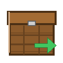

# 分类箱 (Sorting Box)

一个 Minecraft 26.3 (Fabric) 的自动分类模组：用分类标签标记箱子后，分类箱会自动把物品分发到对应分类的箱子。



## 功能

- **分类箱**：27 格容器，自动把物品分发到被标签标记的箱子（128 格范围）
- **分类工作台**：熔炉式界面，放入「通用标签 + 标志物」即可制得对应分类的标签
- **分类标签**：14 个可编辑分类（木类、石类、矿物、装饰、植物、功能物品、红石、装备、武器、工具、附魔书、食物、原材料、其他）
- **分发规则**：只发给被标记的箱子；同类物品优先；同分类多箱子按标记先后顺序
- **可视化**：F7 显示分类箱与目标箱的框线和连线；Jade 悬停显示分类
- **可选集成**：豹猫指示牌（OcelotSignMod + mishanguc）——标记箱子时在箱子正面自动贴上分类标牌

## 安装

| 依赖 | 版本 |
|---|---|
| Minecraft | 26.3 |
| Fabric Loader | ≥ 0.16.0 |
| Fabric API | ≥ 0.160.0 |
| Jade / Mod Menu / JEI | 可选 |
| OcelotSignMod + mishanguc | 可选（标牌集成） |

把 `sortingbox-x.y.z.jar` 放进 `.minecraft/mods` 即可。客户端与服务端都需要安装。

## 使用方法

1. 合成分类箱（8 钻石 + 箱子）与分类工作台（8 钻石 + 工作台）；
2. 在分类工作台里放入「通用标签 + 标志物」得到分类标签；
3. 手持分类标签右键箱子 → 标记分类（再次右键取消）；
4. 把物品放进分类箱，自动分发；
5. 按 **F7** 查看连接线，安装 Jade 可悬停查看分类。

## 配置

- `config/sortingbox/categories.json`：分类与物品/标签规则（可自定义分类，随模组更新自动合并）
- `config/sortingbox/client.json`：标牌集成开关、标牌字号

## 构建

本项目使用纯 `javac` 构建（Java 25），无 Gradle/Loom。参考 `build.bat`（如存在）或自行编译：

```bash
javac --release 25 -encoding UTF-8 -cp "<dependencies>" -d build/classes @sources.txt
```

## 许可

MIT License，作者：摆。

## 致谢

- 豹猫指示牌集成基于 [OcelotSignMod](https://github.com/Creeper-Cola123/ocelotsignmod-minecraft) 与 [迷上城建](https://github.com/SolidBlock-cn/mishanguc)（均为 LGPL-3.0），仅作可选集成，不包含其代码。
注：此为作者自行ai升级的26.3版本，可参考使用。https://pan.quark.cn/s/1f6ae5ae2343
